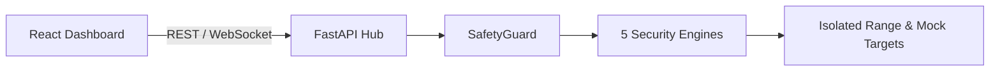

# AegisForge

**Defensive Purple-Team Cyber Range & Vulnerability Analysis Workbench**

AegisForge is a modular platform that pairs offensive vulnerability analysis with real-time defensive controls. Built for local security education, research, and purple-team simulations, all operations are isolated within private RFC 1918 subnets and controlled sandboxes.



---

## Key Modules

| Engine | Primary Function | Defensive Control |
|---|---|---|
| **Recon & CVD** | Scoped network port mapper & banner grabber | Scope validation & RFC 9116 advisory export |
| **Network Arena** | 3-node micro-network simulation | Dynamic ARP Inspection (DAI) & static table pinning |
| **Exploit Studio** | Shellcode disassembler & badchar auditor | Interactive Stack Canary, NX/DEP, ASLR visualizer |
| **Fuzz & RE** | Stateful protocol mutation fuzzer | Windows Security Descriptor / ACL privilege auditor |
| **Malware Triage** | Shannon entropy calculator & string extractor | YARA-style signatures & MITRE ATT&CK mapping |

---

## Quickstart

### Prerequisites
- Python 3.11+
- Node.js 20+ & npm
- Docker (optional, for containerized network testing)

### Installation
```bash
# 1. Install backend dependencies
pip install -e ./backend
pip install typer rich pytest pytest-asyncio

# 2. Install frontend dependencies
cd frontend && npm install && cd ..

# 3. Generate benign test artifacts
python sandbox/sample_artifacts/generate_benign_samples.py
```

### Running Tests
```bash
# Run backend pytest suite (26 tests)
python -m pytest backend/tests -v

# Build frontend production bundle
cd frontend && npm run build && cd ..
```

### CLI Companion (`aegisctl`)
```bash
# Run full purple-team simulation in terminal
python cli/aegisctl.py demo

# Audit shellcode payload
python cli/aegisctl.py shellcode "9090909031c0c3"

# Static triage of benign artifact
python cli/aegisctl.py triage sandbox/sample_artifacts/sample_synthetic.elf
```

### Starting the Web Dashboard
```bash
# Terminal 1: Backend API
uvicorn backend.app.main:app --reload --host 127.0.0.1 --port 8000

# Terminal 2: Frontend Dashboard
cd frontend && npm run dev
```

Access the dashboard at `http://localhost:5173`.
