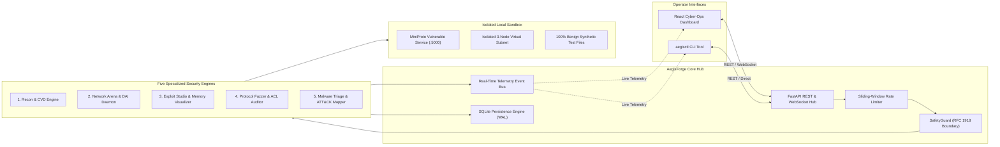

<div align="center">

# 🛡️ AegisForge

**Industry-Grade Purple-Team Cyber Range & Defensive Vulnerability Workbench**

[](https://github.com/yashwantraj147-eng/aegisforge/actions)
[](https://github.com/yashwantraj147-eng/aegisforge)
[](https://www.python.org/)
[](https://www.typescriptlang.org/)
[](https://react.dev/)
[](https://tailwindcss.com/)
[](LICENSE)
[](docs/ETHICAL_DISCLOSURE_GUIDE.md)

<p align="center">
  <b>AegisForge</b> bridges the gap between offensive vulnerability discovery and real-time defensive countermeasures.<br>
  Built for purple-team researchers, security engineers, and educational cyber ranges with strictly bounded local sandboxes.
</p>

[Key Features](#key-features) • [Architecture](#architecture) • [Quickstart](#quickstart) • [CLI Companion](#cli-companion-aegisctl) • [Dual Execution Mode](#dual-execution-mode) • [Documentation](#documentation) • [Ethical Policy](#ethical-policy--safety-guardrails)

</div>

---

## Architecture

AegisForge combines a high-concurrency **FastAPI** backend with an event-driven **WebSocket telemetry broadcaster**, a reactive **React + TypeScript** cyber-ops dashboard, an ergonomic **Rich CLI companion**, and an isolated **Dockerized sandbox**.



---

## Key Features

| Engine / Module | Offensive Simulation | Defensive Countermeasure & Mitigation |
|---|---|---|
| **Module 1: Recon & CVD** | Scoped network port mapper, TCP SYN probe, and banner grabbing | Strict RFC 1918 boundary enforcement, CVSS v3.1 calculator, and standardized Markdown/HTML CVD advisory generator |
| **Module 2: Network Arena** | Simulated ARP cache poisoning & Man-in-the-Middle (MITM) traffic redirection | Dynamic ARP Inspection (DAI), authoritative counter-ARP broadcast, and static ARP table pinning |
| **Module 3: Exploit Studio** | x86/x64 shellcode disassembler, bad-char detector (`\x00`, `\x0a`, etc.), and NOP sled tracker | Interactive stack memory visualizer with live toggles for Stack Canary (SSP), NX/DEP, ASLR, and PIE |
| **Module 4: Fuzzing & RE** | Stateful mutation protocol fuzzer with bit-flip, boundary integer, format string, and oversized buffer engines | Crash triage with register snapshot (RIP/RSP), static ELF/PE header mitigation parser, and Windows ACL auditor |
| **Module 5: Malware Triage** | Static inspection of benign binaries, strings extraction, and IOC identification | Shannon entropy sliding-window analyzer, YARA-style signature engine, and automated MITRE ATT&CK mapping |
| **Module 6: Purple Orchestrator**| Automated 1-click end-to-end multi-stage purple-team attack & defense exercise | Real-time WebSocket telemetry stream, structured audit history in SQLite, and executive summary reporting |

---

## Dual Execution Mode

AegisForge supports two execution paradigms out of the box:

- **`SIMULATION` Mode (Default)**: Zero-privilege execution requiring **no root access and no Docker**. Anyone on Windows, macOS, or Linux can clone the repository, run tests, spin up the web dashboard, and observe realistic telemetry, simulated packet flows, and memory layouts immediately.
- **`DOCKER_LIVE` Mode**: Spins up an isolated bridge subnet (`192.168.100.0/24`) with real container nodes, live raw packet sockets (`AF_PACKET`), and compiled vulnerable C targets for live testing.

---

## Quickstart

### Prerequisites
- **Python**: 3.11+ (Python 3.11, 3.12, or 3.13)
- **Node.js**: v20+ or v22+ LTS & npm
- **Docker** *(Optional, for live container sandbox)*

### 1. Installation
```bash
# Clone the repository
git clone https://github.com/yashwantraj147-eng/aegisforge.git
cd aegisforge

# Set up Python backend
python -m venv venv
# Windows: .\venv\Scripts\Activate.ps1 | Linux/macOS: source venv/bin/activate
pip install -e ./backend
pip install typer rich pytest pytest-asyncio pytest-cov ruff

# Set up React frontend
cd frontend && npm install && cd ..

# Generate benign synthetic test files
python sandbox/sample_artifacts/generate_benign_samples.py
```

### 2. Run Tests
```bash
# Run full backend test suite (45 integration & unit tests)
python -m pytest backend/tests -v

# Verify frontend production build
cd frontend && npm run build && cd ..
```

### 3. Start the Development Servers
```bash
# Terminal 1: FastAPI Backend
uvicorn backend.app.main:app --reload --host 127.0.0.1 --port 8000

# Terminal 2: React Dashboard
cd frontend && npm run dev
```

Visit the dashboard at `http://localhost:5173`.  
Interactive API Swagger docs are available at `http://localhost:8000/docs`.

---

## CLI Companion (`aegisctl`)

AegisForge includes a sleek command-line interface powered by **Typer** and **Rich** for automated headless workflows:

```bash
# Display system version & configuration
python cli/aegisctl.py version

# Check backend health & telemetry connectivity
python cli/aegisctl.py health

# Execute 1-click end-to-end Purple-Team scenario
python cli/aegisctl.py demo

# Audit and disassemble shellcode
python cli/aegisctl.py shellcode "9090909031c050682f2f7368682f62696e89e3505389e131d2b00bcd80" --arch x86

# Run stateful protocol fuzzing campaign
python cli/aegisctl.py fuzz --target 127.0.0.1 --port 5000 --cases 100

# Static triage of benign artifact
python cli/aegisctl.py triage sandbox/sample_artifacts/sample_synthetic.elf

# Generate Coordinated Vulnerability Disclosure (CVD) advisory
python cli/aegisctl.py report --title "Buffer Overflow in Protocol Handler" --severity CRITICAL -o advisory.md
```

---

## Dashboard Tour

```text
+-----------------------------------------------------------------------------------+
|  AEGISFORGE CYBER-OPS  [SIMULATION MODE]  [WS: CONNECTED]   [⚡ TRIGGER SCENARIO]  |
+---------------------+-------------------------------------------------------------+
| [Overview]          |  EXECUTIVE TELEMETRY MATRIX                                 |
| [Recon & CVD]       |  +---------------------+ +------------------+ +-----------+ |
| [Network Arena]     |  | Total Probes: 1,420 | | Scenarios Run: 8 | | Alerts: 2 | |
| [Exploit Studio]    |  +---------------------+ +------------------+ +-----------+ |
| [Fuzz & RE]         |                                                             |
| [Malware Triage]    |  NETWORK TOPOLOGY CANVAS (Interactive SVG)                  |
|                     |  [Gateway :1] <====== [Attacker :200] ======> [Victim :105] |
|                     |                                                             |
|                     |  LIVE THREAT & TELEMETRY STREAM                             |
|                     |  [CRITICAL] ARP Poisoning detected from 02:42:c0:a8:64:c8   |
|                     |  [SUCCESS]  Dynamic ARP Inspection pinned valid gateway MAC |
+---------------------+-------------------------------------------------------------+
```

- **Interactive Topology Graph**: Live SVG visualization with animated traffic arcs and node state indicators.
- **Toast Notifications**: Real-time feedback for operational events, rate limits, and errors.
- **Hash-Based Routing**: Deep-link directly to `#overview`, `#recon`, `#netarena`, `#exploit`, `#fuzzre`, or `#maltriage`.
- **CVD Advisory Exporter**: One-click download of formatted Markdown (`.md`) reports or print-to-PDF views.

---

## Documentation

- [System Architecture Specification](docs/ARCHITECTURE.md) - In-depth engineering diagrams, SQLite threading model, and sequence flows.
- [REST & WebSocket API Reference](docs/API.md) - Complete endpoints guide with curl examples, schemas, and error codes.
- [Ethical Disclosure Guide](docs/ETHICAL_DISCLOSURE_GUIDE.md) - Responsible disclosure standards, legal boundaries, and RFC 9116 templates.
- [Contributing Guidelines](CONTRIBUTING.md) - Development environment setup, coding standards, and PR workflows.
- [Security Policy](SECURITY.md) - Confidential vulnerability disclosure and reporting policy.
- [Changelog](CHANGELOG.md) - Full version release history.

---

## Ethical Policy & Safety Guardrails

AegisForge is governed by strict technical safety controls:
1. **Target Allowlisting**: Probes, scans, and fuzzing campaigns can **only** target loopback (`127.0.0.0/8`, `::1`), RFC 1918 private subnets (`10.0.0.0/8`, `172.16.0.0/12`, `192.168.0.0/16`), and internal sandboxes. All external WAN destinations are blocked by `SafetyGuard`.
2. **Zero Weaponized Malware**: No live or infectious malware binaries exist in this repository. All triage samples are synthetic, deterministic, or standard test files (such as EICAR).
3. **Dual Purple-Team Intent**: Every offensive probe capability is engineered alongside its defensive detection or prevention mechanism.

---

## License

This project is licensed under the [MIT License](LICENSE).
