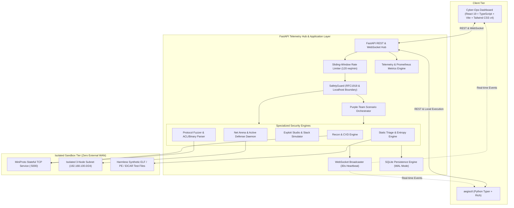
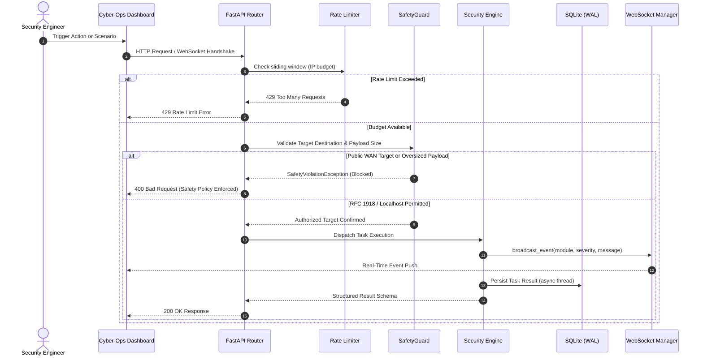
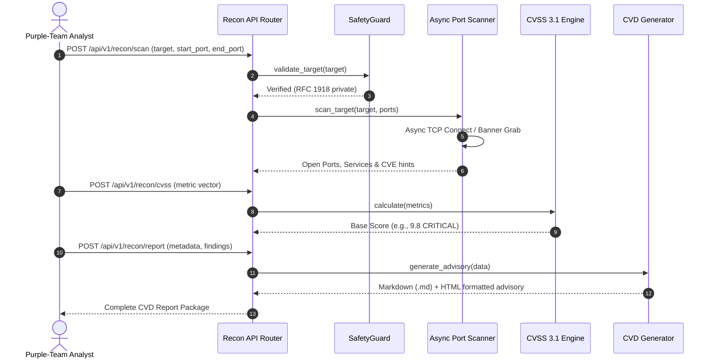
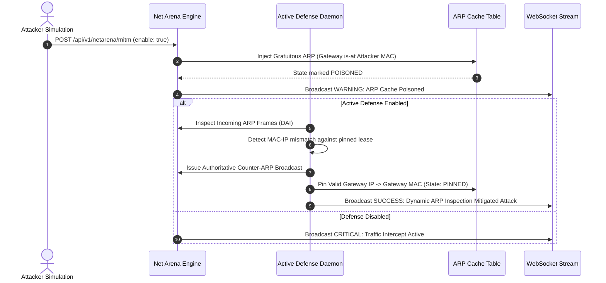
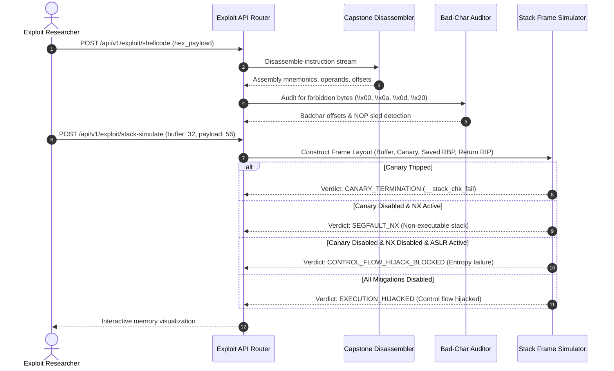
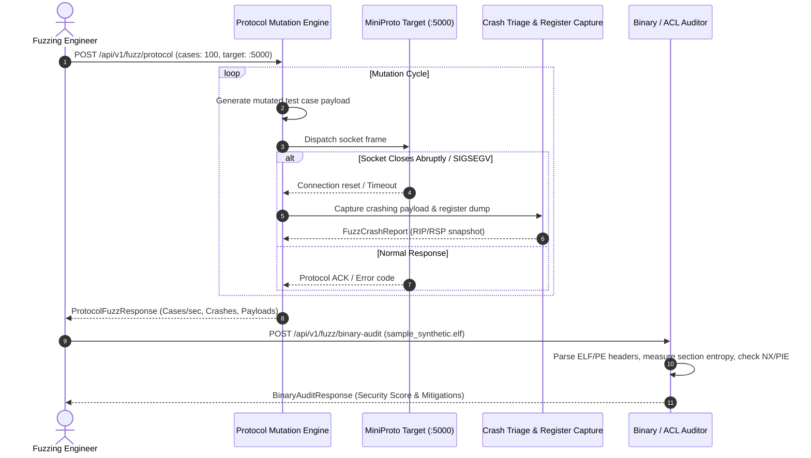
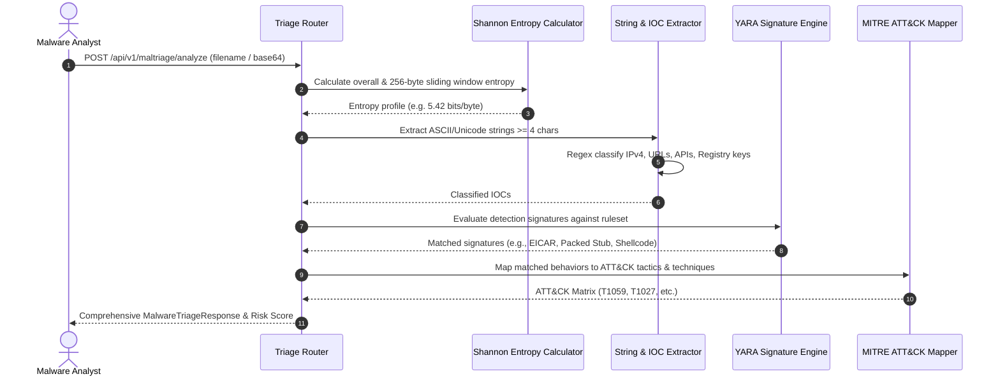

# AegisForge Architecture & Engineering Specification

## 1. System Overview
AegisForge is an integrated purple-team cyber range and defensive vulnerability analysis platform. It provides a synchronized environment where offensive discovery techniques and defensive mitigations are studied side-by-side within strictly bounded local sandbox environments.



---

## 2. Telemetry and Event Flow
During active testing or when running an automated end-to-end purple-team scenario, events flow through the central telemetry broadcaster:



---

## 3. Security Engine Sequence Architectures

### 3.1 Module 1: Recon & Coordinated Vulnerability Disclosure (CVD)
The Recon module ensures target IP/CIDR boundaries are verified before any network socket connection is established. It maps open ports, gathers service banners, correlates known CVE identifiers, calculates CVSS v3.1 base metrics, and formats standardized disclosure advisories.



---

### 3.2 Module 2: Network Arena & Active Defense Daemon
The Network Arena models an internal virtual bridge between three nodes:
1. **Gateway** (`192.168.100.1`)
2. **Victim** (`192.168.100.105`)
3. **Monitor/Attacker** (`192.168.100.200`)

It simulates adversary ARP cache poisoning and demonstrates Dynamic ARP Inspection (DAI) defense.



---

### 3.3 Module 3: Exploit Studio & Memory Simulation
Exploit Studio disassembles raw x86/x64 shellcode using Capstone, audits for forbidden null/bad bytes, and provides an interactive visualizer for x86/x64 CPU stack call frames under buffer overflow conditions.



---

### 3.4 Module 4: Fuzzing & Reverse Engineering Engine
This engine combines a stateful protocol mutation fuzzer (with bit-flip, boundary integer, format string, and oversized buffer strategies) with static ELF/PE binary header analysis and Windows ACL security descriptor auditing.



---

### 3.5 Module 5: Malware Triage Engine
The static artifact triage engine evaluates benign synthetic binaries and test files: calculating overall and sliding-window Shannon entropy, extracting and categorizing strings and IOCs, matching detection signatures, and mapping findings to the MITRE ATT&CK framework.



---

### 3.6 Automated Purple-Team Scenario Orchestrator
The orchestrator coordinates a synchronized, multi-phase exercise spanning all five security engines:

```mermaid
sequenceDiagram
    autonumber
    actor Commander as Purple-Team Lead
    participant Orch as Scenario Orchestrator
    participant WS as WebSocket Hub
    participant Recon as Recon Engine
    participant Net as Net Arena
    participant Fuzz as Fuzzing Engine
    participant Exploit as Exploit Studio
    participant Triage as Triage Engine
    participant DB as SQLite DB

    Commander->>Orch: POST /api/v1/scenarios/run-purple-team
    Orch->>WS: Broadcast START: Purple-Team Scenario
    
    rect rgb(20, 30, 50)
        Note over Orch,Recon: Phase 1: Reconnaissance
        Orch->>Recon: Execute port probe on local range
        Recon-->>Orch: Discovered services
        Orch->>WS: Broadcast Step 1 SUCCESS
    end

    rect rgb(50, 20, 20)
        Note over Orch,Net: Phase 2: Adversary Emulation
        Orch->>Net: Trigger ARP cache poisoning
        Net-->>Orch: Poisoning established
        Orch->>WS: Broadcast Step 2 COMPROMISED
    end

    rect rgb(20, 50, 20)
        Note over Orch,Net: Phase 3: Active Defense
        Orch->>Net: Deploy Dynamic ARP Inspection & Pinning
        Net-->>Orch: Countermeasure verified, ARP restored
        Orch->>WS: Broadcast Step 3 MITIGATED
    end

    rect rgb(20, 30, 50)
        Note over Orch,Fuzz: Phase 4: Vulnerability Fuzzing
        Orch->>Fuzz: Fuzz MiniProto service
        Fuzz-->>Orch: Boundary crash captured
        Orch->>WS: Broadcast Step 4 VULNERABILITY FOUND
    end

    rect rgb(50, 20, 20)
        Note over Orch,Exploit: Phase 5: Exploit Simulation
        Orch->>Exploit: Simulate stack frame overflow & mitigations
        Exploit-->>Orch: Canary tripped, execution halted safely
        Orch->>WS: Broadcast Step 5 DEFENSE VERIFIED
    end

    rect rgb(20, 30, 50)
        Note over Orch,Triage: Phase 6: Artifact Triage
        Orch->>Triage: Triage synthetic artifact
        Triage-->>Orch: Shannon entropy & MITRE ATT&CK mapping
        Orch->>WS: Broadcast Step 6 COMPLETE
    end

    Orch->>DB: Save complete scenario run
    Orch-->>Commander: ScenarioRunResponse (Full summary & audit trail)
```



---

## 4. Database Architecture & Persistence Layer

AegisForge utilizes a high-throughput, non-blocking SQLite database operating in **Write-Ahead Logging (WAL)** mode.

### Schema Specifications

```sql
-- Scenario execution records
CREATE TABLE IF NOT EXISTS scenario_runs (
    id INTEGER PRIMARY KEY AUTOINCREMENT,
    scenario_id TEXT UNIQUE NOT NULL,
    scenario_title TEXT NOT NULL,
    status TEXT NOT NULL,
    total_steps INTEGER NOT NULL,
    steps_json TEXT NOT NULL,
    summary TEXT,
    created_at TIMESTAMP DEFAULT CURRENT_TIMESTAMP
);

-- Network recon scan history
CREATE TABLE IF NOT EXISTS scan_history (
    id INTEGER PRIMARY KEY AUTOINCREMENT,
    target TEXT NOT NULL,
    open_ports_count INTEGER NOT NULL,
    open_ports_json TEXT NOT NULL,
    scan_duration_ms REAL NOT NULL,
    created_at TIMESTAMP DEFAULT CURRENT_TIMESTAMP
);

-- Protocol fuzzing campaign results
CREATE TABLE IF NOT EXISTS fuzz_campaigns (
    id INTEGER PRIMARY KEY AUTOINCREMENT,
    target TEXT NOT NULL,
    total_cases INTEGER NOT NULL,
    crashes_count INTEGER NOT NULL,
    cases_per_second REAL NOT NULL,
    crashes_json TEXT,
    created_at TIMESTAMP DEFAULT CURRENT_TIMESTAMP
);

-- Static binary triage records
CREATE TABLE IF NOT EXISTS triage_reports (
    id INTEGER PRIMARY KEY AUTOINCREMENT,
    filename TEXT NOT NULL,
    file_type TEXT NOT NULL,
    overall_entropy REAL NOT NULL,
    risk_score REAL NOT NULL,
    verdict TEXT NOT NULL,
    created_at TIMESTAMP DEFAULT CURRENT_TIMESTAMP
);
```

### Threading Model
- All SQLite queries are executed inside worker threads using `asyncio.to_thread` to ensure zero event-loop blocking.
- WAL mode (`PRAGMA journal_mode=WAL`) allows concurrent read transactions alongside background write operations.
