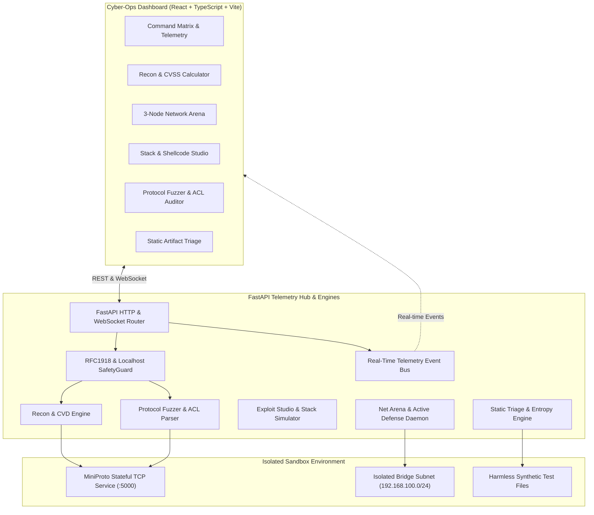
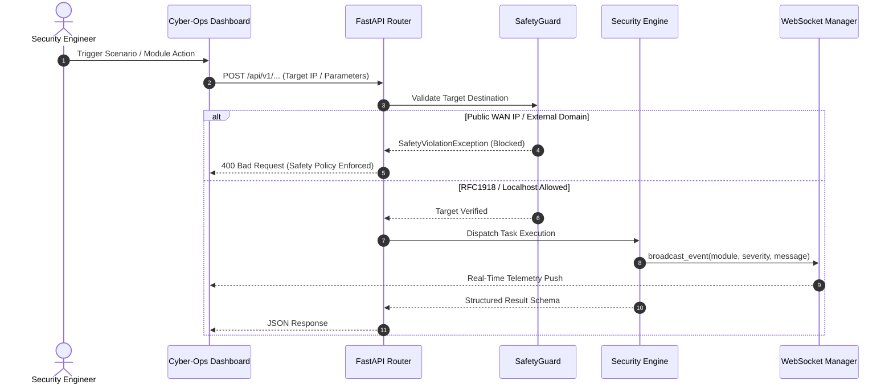

# AegisForge Architecture & Engineering Specification

## 1. System Overview
AegisForge is an integrated purple-team cyber range and defensive vulnerability analysis platform. It provides a synchronized environment where offensive discovery techniques and defensive mitigations are studied side-by-side within strictly bounded local sandbox environments.

---

## 2. Telemetry and Event Flow
During active testing or when running an automated end-to-end purple-team scenario, events flow through the central telemetry broadcaster:

---

## 3. Defense-in-Depth Mechanisms

### 3.1 Strict Safety Guardrails
The `SafetyGuard` module is positioned at the entrypoint of every network probe or socket invocation:
- Permits only RFC 1918 private subnets (`10.0.0.0/8`, `172.16.0.0/12`, `192.168.0.0/16`), loopback (`127.0.0.0/8`, `::1`), link-local addresses, and `.internal` / `.sandbox` hostnames.
- Rejects any external WAN IP or non-whitelisted domain immediately with structured feedback.

### 3.2 Dynamic ARP Inspection & Table Pinning
The Network Arena models an internal virtual bridge with three designated nodes:
1. **Gateway** (`192.168.100.1`)
2. **Victim** (`192.168.100.105`)
3. **Monitor/Attacker** (`192.168.100.200`)

When a rogue gratuitous ARP announcement is detected, the Active Defense Daemon flags the conflict, broadcasts an authoritative correction, and applies static ARP table pinning to neutralize redirection.

### 3.3 Stack Memory & Mitigation Mechanics
The Exploit Studio models standard x86 and x64 call frame structures:
- **Stack Canary (SSP)**: Detects buffer boundary overrun and aborts via `__stack_chk_fail` before the return address can be dereferenced.
- **NX / DEP**: Enforces write-xor-execute permissions, blocking code execution on stack pages.
- **ASLR & PIE**: Randomizes memory layout offsets to prevent fixed-address exploitation.
